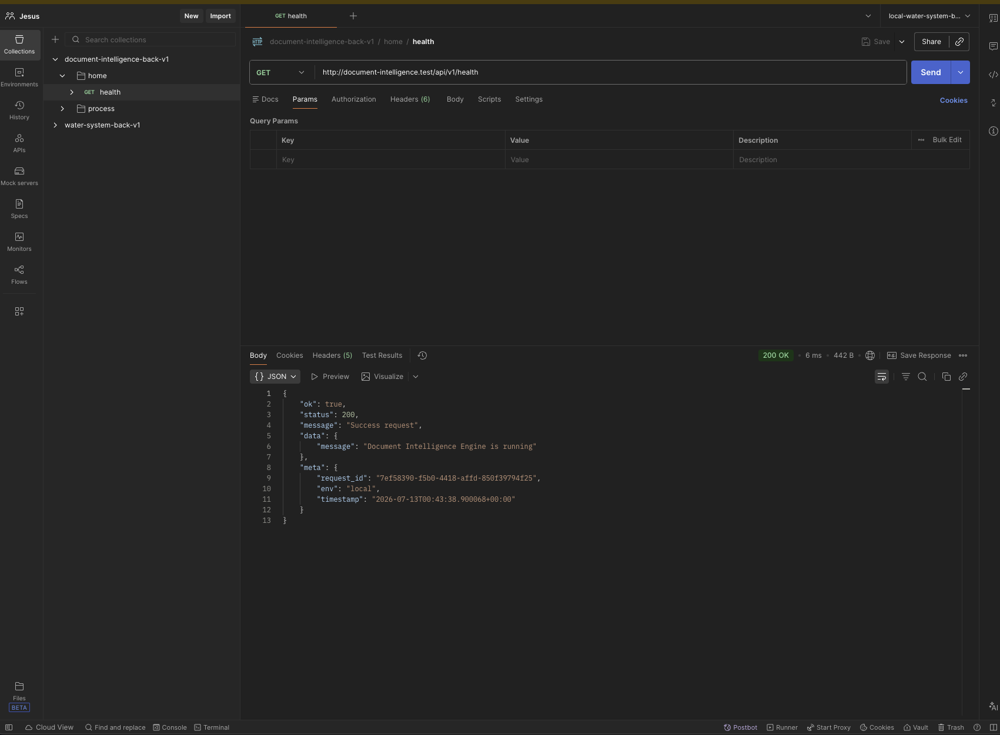
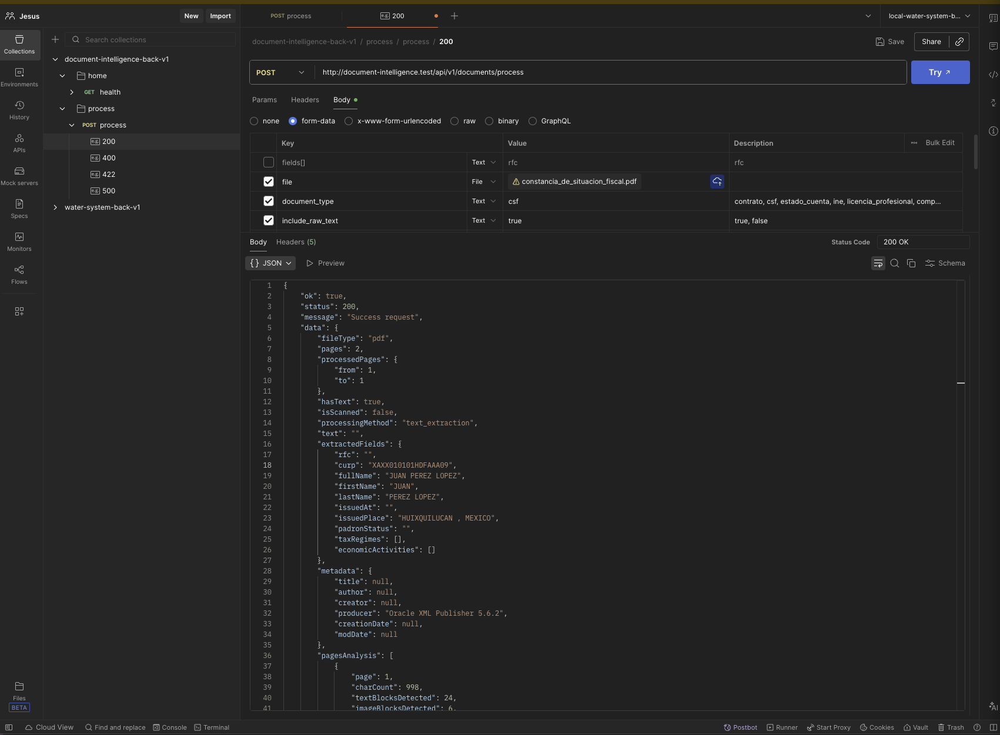
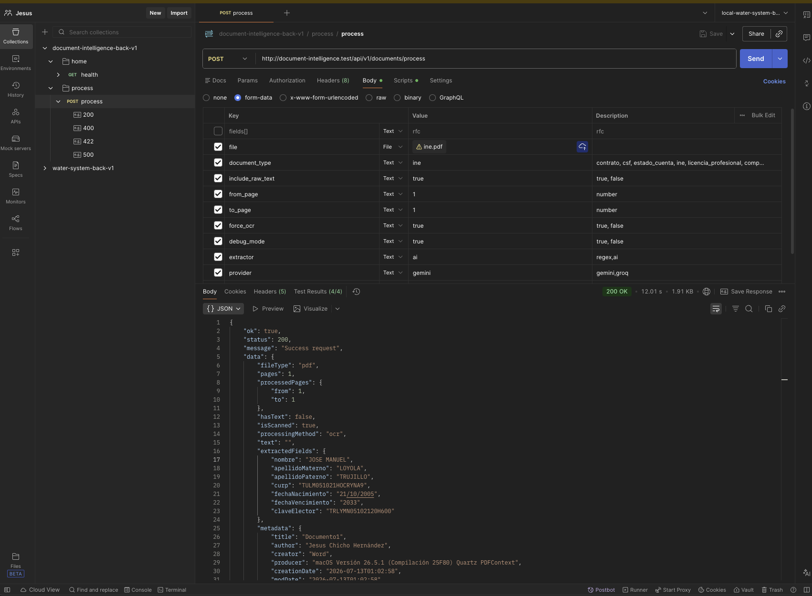
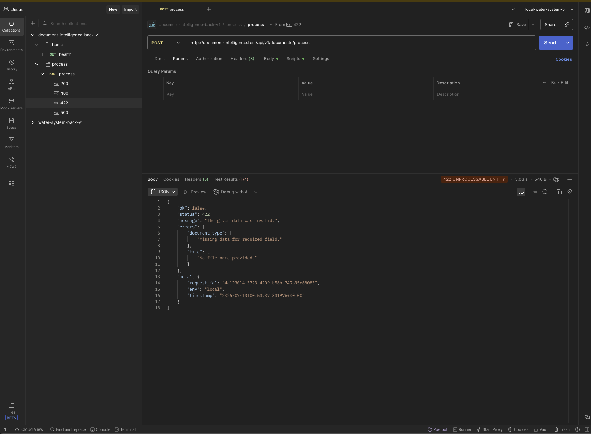

# Document Intelligence Engine

> Versión en inglés: [docs/README.en.md](./docs/README.en.md)

## Desarrollado por: Jesus Chicho Hernández

API Python/Flask de procesamiento documental con IA, patrones de diseño y arquitectura limpia. Proyecto de portafolio que demuestra cómo transformar documentos no estructurados (PDF) en datos estructurados mediante un pipeline extensible: diagnóstico OCR, extracción regex o IA, y respuesta JSON estandarizada.

No es un script OCR aislado: es una plataforma de inteligencia documental donde OCR, extractores y proveedores de IA son capas intercambiables.

---

## ¿Qué resuelve este proyecto?

Recibe documentos PDF (nativos o escaneados), analiza su contenido, decide si requiere OCR, extrae campos relevantes según el tipo de documento y devuelve una respuesta estructurada lista para integrarse en flujos de validación o automatización.

Casos de uso actuales:

- **CSF** (Constancia de Situación Fiscal): extracción regex de RFC, CURP, nombre, régimen fiscal, etc.
- **INE**: extracción vía IA con hints de CURP y soporte multimodal (Gemini).
- **Comprobante de domicilio** (luz, agua, gas, teléfono, internet): extracción vía IA de titular, domicilio desglosado, proveedor, número de servicio y fechas normalizadas a ISO.

---

## Highlights técnicos

- **Arquitectura limpia**: Controller → Service → Factory → Processor/Extractor, con contratos e inversión de dependencias.
- **Patrones de diseño**: Strategy (procesadores, extractores, OCR) y Factory (selección dinámica por tipo de archivo y documento).
- **Pipeline PDF inteligente**: PyMuPDF diagnostica densidad de texto y decide entre extracción embebida u OCR.
- **OCR**: páginas rasterizadas a 400 DPI y recortadas a la zona con contenido (a color, sin gris), Tesseract con modo de texto disperso como respaldo, y corrección por posición de errores típicos del OCR en CURP y clave de elector.
- **IA intercambiable**: `AiExtractor` con providers Gemini (imagen + texto) y Groq (solo texto).
- **Validación de entrada**: Marshmallow schemas, excepciones centralizadas, logging estructurado.
- **Contenedorización y CI**: Docker + nginx como reverse proxy; GitHub Actions corre pytest en cada PR.

---

## Estado del proyecto

Fase actual, qué funciona hoy, bugs conocidos y siguiente paso: **[docs/project/STATUS.md](./docs/project/STATUS.md)** (única fuente de estado).

---

## Stack tecnológico

| Capa | Tecnología |
|------|------------|
| Lenguaje | Python 3.12 |
| Framework | Flask 3 |
| PDF | PyMuPDF, pdf2image |
| OCR | Tesseract, pytesseract |
| Imagen | Pillow |
| Validación | Marshmallow |
| IA | Google Gemini, Groq (HTTP con `requests`) |
| Tests | pytest |
| Infra | Docker, nginx, GitHub Actions |

---

## Arquitectura

```text
Client
  ↓
POST /api/v1/documents/process
  ↓
Controller → DocumentService
  ↓
DocumentProcessorFactory → PdfProcessor
  ↓
Diagnosis (OCR required?)
  ├── NO  → Embedded text extraction
  └── YES → TesseractOcr (páginas del rango recortadas al contenido → texto)
  ↓
ExtractorFactory
  ├── CsfExtractor (regex)
  ├── AiExtractor → Gemini (PDF de las páginas del rango + texto) / Groq (solo texto)
  └── PassthroughExtractor (fallback regex)
  ↓
JSON Response (camelCase fields)
```

Diseño, patrones y decisiones de arquitectura: [docs/project/PROJECT_PLAN.md](./docs/project/PROJECT_PLAN.md)

---

## Estructura del repo

```text
document-intelligence-engine/
├── app/
│   ├── config/              # Config (única fuente de variables de entorno) + logging
│   ├── contracts/           # DocumentProcessorInterface
│   ├── controllers/         # DocumentController (sin lógica de negocio)
│   ├── exceptions/          # AppException + handler global
│   ├── extractors/          # BaseExtractor, CsfExtractor, AiExtractor, PassthroughExtractor
│   │   └── ai/              # BaseAiExtractor, GeminiExtractor, GroqExtractor
│   ├── factories/           # DocumentProcessorFactory, ExtractorFactory
│   ├── helpers/             # ResponseHelper, Logger, request_context (request id)
│   ├── ocr/                 # BaseOcr, TesseractOcr
│   ├── processors/
│   │   ├── base/
│   │   ├── pdf/             # PdfProcessor (diagnóstico OCR)
│   │   └── image/ excel/ csv/ word/   # scaffolds vacíos (planificados)
│   ├── routes/              # Blueprint /api/v1
│   ├── schemas/             # Schemas marshmallow
│   ├── services/            # DocumentService (orquestador)
│   ├── utils/               # curp_decoder, case_converter
│   └── validators/          # Validación de request (decorador)
├── tests/                   # pytest
├── docs/
│   ├── project/             # PROJECT_PLAN.md (diseño y roadmap), STATUS.md (estado)
│   ├── screenshots/         # Capturas de Postman usadas en este README
│   └── README.en.md         # Este README en inglés
├── docker/                  # Dockerfile (Python 3.12 + Tesseract + poppler)
├── nginx/                   # Reverse proxy
├── scripts/                 # up, verify, smoke, doctor (los llama el Makefile) y generate_samples.py
├── samples/                 # Muestras: INE pública y comprobantes ficticios (scripts/generate_samples.py)
├── storage/                 # debug/, logs/ (generados en runtime, ignorados por git)
├── uploads/                 # Uploads temporales (ignorados por git)
├── .github/workflows/       # CI (pytest)
├── .githooks/               # pre-push que bloquea push directo a main/develop
├── .claude/                 # Hook y skills de Claude Code
├── AGENTS.md                # Contexto y reglas para cualquier asistente de IA
├── CLAUDE.md, GEMINI.md     # Solo importan AGENTS.md
├── docker-compose.yml
├── Makefile                 # Atajos: make up, make test, make verify…
├── index.py                 # Entry point Flask
├── requirements.txt
├── NOTICE.txt
└── .env.example
```

---

## Desarrollo local

**Docker es el entorno principal** de desarrollo: trae Python 3.12, Tesseract con español y poppler, y es lo que usan los ejemplos de este README. Correr con Python local es **opcional** (ver al final de esta sección).

### Requisitos

- [Docker Desktop](https://www.docker.com/products/docker-desktop/) corriendo
- `make` (viene con macOS/Linux)
- Entrada en `/etc/hosts`: `127.0.0.1 document-intelligence.test` (dominio local que atiende nginx)
- Claves de API solo si usas `extractor=ai`: `GEMINI_API_KEY` y/o `GROQ_API_KEY`

> **Cuentas gratuitas de IA.** Las dos claves pueden ser del plan gratuito, que tiene límites de peticiones (Gemini, en octubre de 2026: **20 peticiones por día por modelo** en `gemini-3.6-flash`). Al pasarlo, la API responde 503 con `exceeded its quota (<cuota>, limit N); retry in …`. El tiempo de espera lo estima el proveedor y no es exacto (Google dijo ~9 h y aceptó una petición 83 s después). Mientras tanto, usa el otro proveedor (`provider=groq` / `provider=gemini`) o pasa la cuenta a un plan de pago. Límites vigentes: [Gemini](https://ai.google.dev/gemini-api/docs/rate-limits) · [Groq](https://console.groq.com/docs/rate-limits).

`make doctor` revisa todo esto (solo lee, no instala nada).

### Primer arranque

```bash
git clone <repo-url>
cd document-intelligence-engine
cp .env.example .env                    # edita las claves de IA si las vas a usar
echo "127.0.0.1 document-intelligence.test" | sudo tee -a /etc/hosts   # dominio local (una sola vez por máquina)
git config core.hooksPath .githooks     # activa el pre-push que protege main/develop
make doctor                             # revisa requisitos
make build                              # construye la imagen y levanta en segundo plano
make smoke                              # health + OCR real sobre samples/pdf/ine_sample.pdf
```

API en **http://document-intelligence.test** (nginx en el puerto 80 → Flask en app:5000).

### Comandos del día a día

| Comando | Qué hace |
|---|---|
| `make up` | Levanta en segundo plano y espera a que la API responda (healthcheck). No ocupa la terminal |
| `make build` | Igual, pero reconstruye la imagen. Solo hace falta si cambian `requirements.txt` o el `Dockerfile` |
| `make down` | Apaga y elimina los contenedores |
| `make restart` | Reinicia solo el proceso de la API. **No** recarga `.env`: para eso, `make up` |
| `make logs` | Sigue los logs de Flask. Ctrl+C sale de los logs, **no apaga nada** |
| `make ps` | Estado de los contenedores |
| `make shell` | Shell dentro del contenedor de la API |
| `make test` | pytest dentro del contenedor (`make test ARGS="-k csf"` para filtrar) |
| `make verify` | Lo mismo que corre el CI; úsalo antes de hacer push |
| `make smoke` | Prueba de punta a punta a través de nginx |
| `make doctor` | Requisitos de la máquina, `.env`, `/etc/hosts`, puerto 80 y hooks |

`make` sin argumentos lista los comandos. La lógica vive en `scripts/`; el `Makefile` solo da los atajos.

- El código está montado como volumen y Flask corre en modo debug: los cambios en `app/` se recargan solos, sin reconstruir.
- Con `restart: unless-stopped`, los contenedores vuelven a levantar cuando reinicias Docker Desktop, salvo que los hayas apagado con `make down`.

### Problemas comunes

| Síntoma | Causa y solución |
|---|---|
| La terminal se queda mostrando logs | Se corrió `docker compose up` sin `-d`. Usa `make up`. En primer plano, Ctrl+C apaga los contenedores y Ctrl+Z solo suspende la terminal (al cerrarla se detienen) |
| `port is already allocated` | Otro proyecto quedó arriba en el puerto 80. Apágalo (`make down` en ese proyecto). `make doctor` te dice quién lo ocupa |
| `document-intelligence.test` no responde | Falta la entrada en `/etc/hosts` (`make doctor` lo revisa) o los contenedores están abajo (`make ps`) |
| Cada petición tarda ~5 s | `/etc/resolver/test` manda los `.test` al DNS de Laravel Herd y Herd está apagado: macOS espera 5 s antes de usar `/etc/hosts`. Arranca Herd o revisa ese archivo. `make doctor` lo detecta (línea `dns`) |
| `env file .env not found` | Falta `cp .env.example .env` |
| Cambié `requirements.txt` y no se refleja | `make build` |
| `extractor=ai` responde 503 | Lee el mensaje: **"is not configured"** → falta la clave (`GEMINI_API_KEY` / `GROQ_API_KEY`) en `.env`; agrégala y `make up` (`make restart` no recarga `.env`). **"exceeded its quota (…)"** → se agotó la cuota del proveedor: dice cuál y cuándo se reinicia (el plan gratuito de Gemini permite 20 peticiones por día por modelo); espera o usa el otro proveedor. **"temporarily unavailable"** → el proveedor está saturado; reintenta en unos segundos |
| `extractor=ai` responde 502 o 504 | El proveedor falló: el mensaje dice por qué (HTTP, respuesta bloqueada o truncada, timeout). Un `HTTP 404` suele ser un modelo apagado: revisa `GEMINI_MODEL` / `GROQ_MODEL` contra las páginas de deprecaciones |

### Opcional: Python local (sin Docker)

Solo si quieres correr la API o los tests fuera de Docker. Requiere Python 3.12 (el de macOS es 3.9 y no sirve), Tesseract con español y poppler:

```bash
brew install python@3.12 tesseract tesseract-lang poppler
python3.12 -m venv venv && source venv/bin/activate
pip install -r requirements.txt
python index.py      # http://localhost:5000 (sin nginx)
pytest tests/ -v
```

---

## Variables de entorno

Consulta [.env.example](./.env.example). Variables principales:

| Variable | Descripción |
|----------|-------------|
| `APP_ENV` | Entorno (`local`, `production`) |
| `APP_DEBUG` | Modo debug Flask |
| `MAX_FILE_SIZE_MB` | Tamaño máximo de archivo (default: 10) |
| `DEFAULT_EXTRACTOR` | Extractor por defecto (`regex` o `ai`) |
| `AI_PROVIDER` | Provider IA por defecto (`gemini` o `groq`) |
| `GEMINI_API_KEY` | Clave API de Google Gemini |
| `GROQ_API_KEY` | Clave API de Groq |
| `GEMINI_MODEL` / `GROQ_MODEL` | Modelos (default `gemini-3.6-flash` / `openai/gpt-oss-120b`) |
| `GEMINI_THINKING_LEVEL` / `GROQ_REASONING_EFFORT` | Nivel de razonamiento (`low`); vacío para modelos que no lo soportan |

---

## API Endpoints

Base URL: `/api/v1`

Cada respuesta trae un `meta.request_id` y el mismo valor en el header `X-Request-ID`; también aparece en cada línea de log (`make logs`), así que sirve para rastrear una petición concreta. Los uploads que pasan el límite (`MAX_FILE_SIZE_MB`) responden 413 o 422.

### GET /health

Verifica que el servicio esté activo.

**Response:**

```json
{
  "ok": true,
  "status": 200,
  "message": "Success request",
  "data": {
    "message": "Document Intelligence Engine is running"
  },
  "meta": {
    "request_id": "uuid",
    "env": "local",
    "timestamp": "2026-07-11T07:00:00+00:00"
  }
}
```

### POST /documents/process

Procesa un documento PDF y extrae campos según tipo y estrategia.

**Content-Type:** `multipart/form-data`

| Parámetro | Tipo | Requerido | Descripción |
|-----------|------|-----------|-------------|
| `file` | file | Sí | PDF (máx. 10 MB) |
| `document_type` | string | Sí | `ine`, `csf`, `comprobante_domicilio` |
| `fields` | list | No | Campos a extraer (usa defaults por tipo si se omite) |
| `extractor` | string | No | `regex` o `ai`. Default: `ai` para `ine` y `comprobante_domicilio` (solo IA: `regex` responde 422); `DEFAULT_EXTRACTOR` (`regex`) para `csf` |
| `provider` | string | No | `gemini` o `groq` (solo con `extractor=ai`) |
| `force_ocr` | bool | No | Forzar OCR aunque el PDF tenga texto embebido |
| `from_page` / `to_page` | int | No | Rango de páginas (1-indexed) |
| `all_fields` | bool | No | Extraer todos los campos detectables (IA) |
| `include_raw_text` | bool | No | Incluir texto crudo en respuesta (default: `true`) |
| `debug_mode` | bool | No | Guardar en `storage/debug/{request_id}/` el archivo original, las páginas del rango como imagen, lo que recibió el extractor (texto y, para Gemini, el PDF del rango) y el resultado. Funciona con cualquier documento, con o sin OCR |

#### Ejemplo CSF (regex)

```bash
curl -X POST http://document-intelligence.test/api/v1/documents/process \
  -F "file=@csf.pdf" \
  -F "document_type=csf" \
  -F "extractor=regex" \
  -F "fields=rfc" \
  -F "fields=curp" \
  -F "fields=full_name"
```

**Response (parcial):**

```json
{
  "ok": true,
  "status": 200,
  "message": "Success request",
  "data": {
    "fileType": "pdf",
    "pages": 2,
    "processedPages": { "from": 1, "to": 2 },
    "hasText": true,
    "isScanned": false,
    "processingMethod": "text_extraction",
    "ocrRequired": false,
    "extractedFields": {
      "rfc": "XAXX010101AAA",
      "curp": "XAXX010101HDFAAA09",
      "fullName": "JUAN PEREZ LOPEZ"
    },
    "diagnosis": {
      "reason": "embedded_text_found",
      "confidence": "high"
    }
  }
}
```

#### Ejemplo INE (ai + gemini)

```bash
curl -X POST http://document-intelligence.test/api/v1/documents/process \
  -F "file=@ine.pdf" \
  -F "document_type=ine" \
  -F "extractor=ai" \
  -F "provider=gemini" \
  -F "include_raw_text=false"
```

**Response (parcial):**

```json
{
  "ok": true,
  "status": 200,
  "message": "Success request",
  "data": {
    "fileType": "pdf",
    "processingMethod": "ocr",
    "ocrRequired": true,
    "extractedFields": {
      "nombre": "JUAN",
      "apellidoPaterno": "PEREZ",
      "apellidoMaterno": "LOPEZ",
      "curp": "XAXX010101HDFAAA09",
      "claveElector": "PRPLJN01010109H000"
    },
    "text": null
  }
}
```

#### Ejemplo comprobante de domicilio (ai)

Solo con IA (`extractor` se omite: es el default para `ine` y `comprobante_domicilio`). Sirve para recibos de luz, agua, gas, teléfono o internet, digitales o escaneados. Las fechas se devuelven en ISO (`YYYY-MM-DD`); la app las convierte desde el formato impreso (`14 OCT 26`, `05/10/2026`, siempre día primero).

```bash
curl -X POST http://document-intelligence.test/api/v1/documents/process \
  -F "file=@samples/pdf/comprobante_luz_sample.pdf" \
  -F "document_type=comprobante_domicilio" \
  -F "provider=groq" \
  -F "include_raw_text=false"
```

**Response (parcial, muestra ficticia):**

```json
"extractedFields": {
  "nombreTitular": "XAVIER EJEMPLO PRUEBA",
  "domicilioCompleto": "AV DE LOS EJEMPLOS 123 INT 4, COL. CENTRO, CUAUHTEMOC, CIUDAD DE MEXICO, C.P. 06000",
  "calle": "AV DE LOS EJEMPLOS",
  "numeroExterior": "123",
  "numeroInterior": "4",
  "colonia": "CENTRO",
  "municipio": "CUAUHTEMOC",
  "estado": "CIUDAD DE MEXICO",
  "codigoPostal": "06000",
  "proveedor": "ENERGIA DEL VALLE S.A. DE C.V.",
  "tipoServicio": "luz",
  "numeroServicio": "000123456789",
  "fechaEmision": "2026-10-14",
  "periodoInicio": "2026-08-12",
  "periodoFin": "2026-10-13",
  "fechaLimitePago": "2026-10-28"
}
```

> Screenshots de Postman:  `docs/screenshots/`.

### Health check


### CSF — extracción regex


### INE — extracción con IA


### Validación de entrada (422)


---

## Testing

```bash
make test        # pytest dentro del contenedor
make verify      # lo mismo que el CI, antes de hacer push
make smoke       # prueba de punta a punta (health + OCR) contra la API levantada
```

`make test` y `make verify` corren los mismos tests que GitHub Actions corre en cada PR y push a `main`/`develop` (`.github/workflows/tests.yml`).

---

## Documentación técnica

- [docs/project/STATUS.md](./docs/project/STATUS.md) — fase actual, qué funciona, bugs conocidos, siguiente paso.
- [docs/project/PROJECT_PLAN.md](./docs/project/PROJECT_PLAN.md) — visión, SOLID, patrones, decisiones de arquitectura y roadmap por fases.
- [AGENTS.md](./AGENTS.md) — ciclo de una petición, convenciones y reglas de trabajo (para personas y asistentes de IA).

---

### Licencia

Este proyecto no está licenciado para uso público. Todos los derechos reservados. Para obtener permisos de uso, contacta al propietario del proyecto en chichohdzjesus@gmail.com.

Consulta la licencia completa en [NOTICE.txt](./NOTICE.txt).
